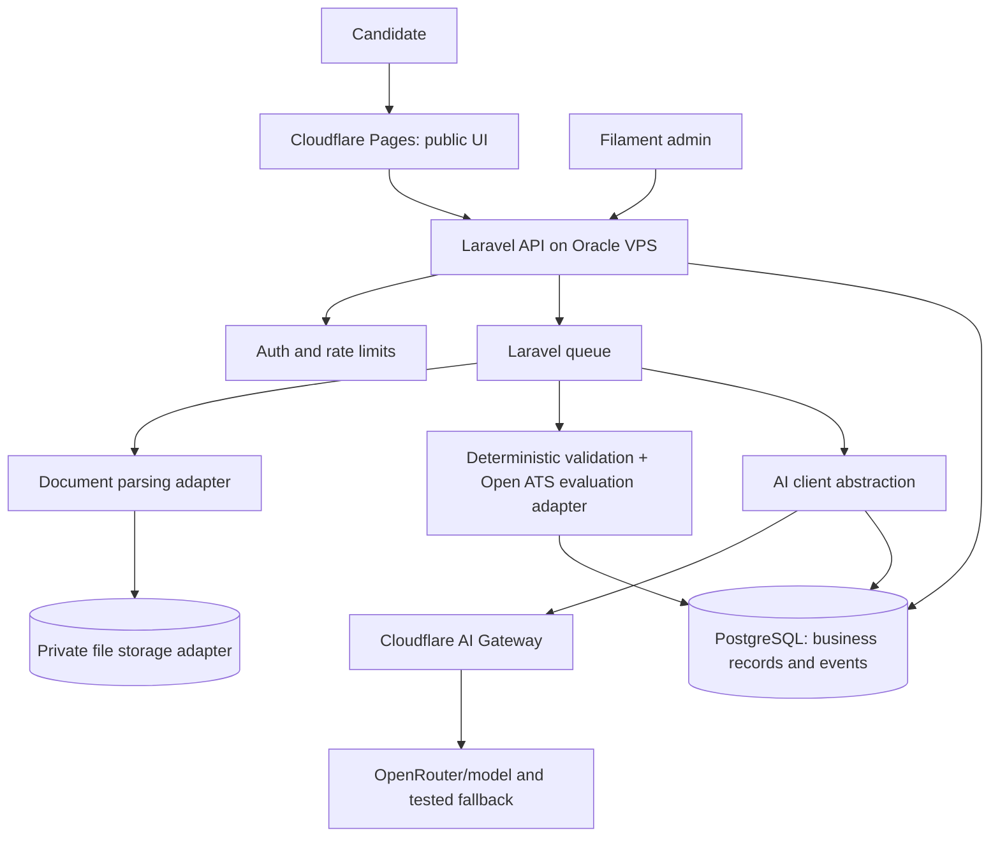

# System Overview

## Trust boundaries

- Browser/public frontend is untrusted.
- Laravel API enforces auth, validation, rate limiting, access checks and business state transitions.
- Uploaded files and CV/JD text are untrusted data and must never become system instructions.
- Model outputs are untrusted until schema, factual consistency and document validators pass.
- Payment redirect query parameters are not proof of payment; signed provider events or verified server-side lookup are required.
- Provider credentials exist only server-side.

## Initial deployment

- Oracle VPS: Docker Compose or existing container management; database and app must have persistent volumes and backup procedures.
- Public frontend: Cloudflare Pages Git integration.
- Backend hostname: separate API hostname routed securely to Laravel, preferably through the existing Cloudflare Tunnel.
- Avoid exposing PostgreSQL publicly.
- Avoid adding Redis, Langfuse or additional microservices until measured need justifies memory/storage/ops cost.

## Technology selection

Laravel monolith first. A small Python adapter may be deployed as a separate internal service only if Open ATS testing justifies it; don't expose it publicly. The adapter boundary uses versioned JSON and a bounded timeout.
